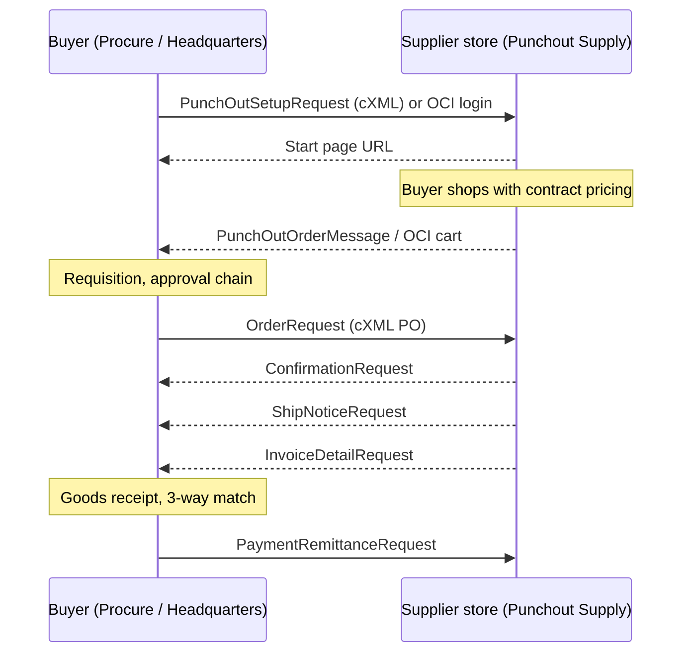
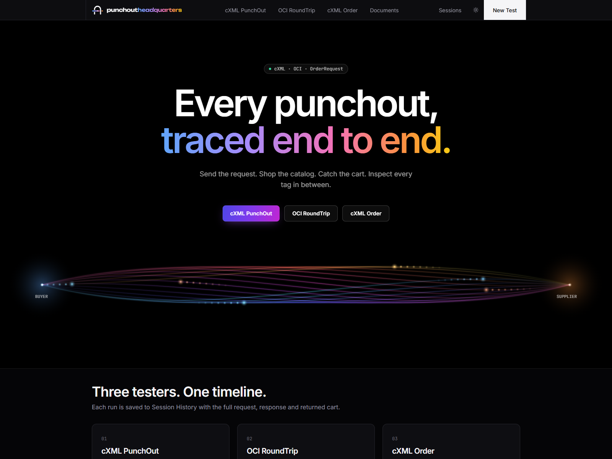
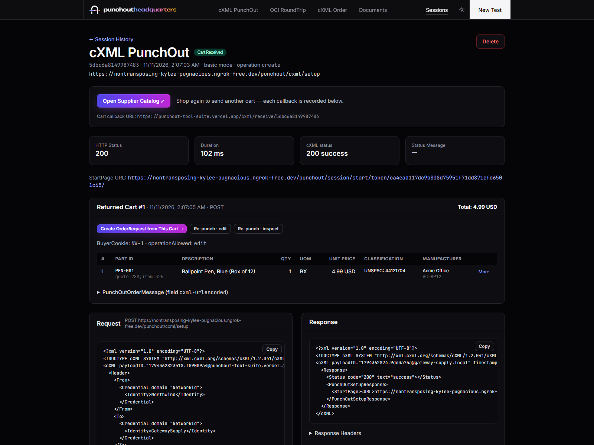
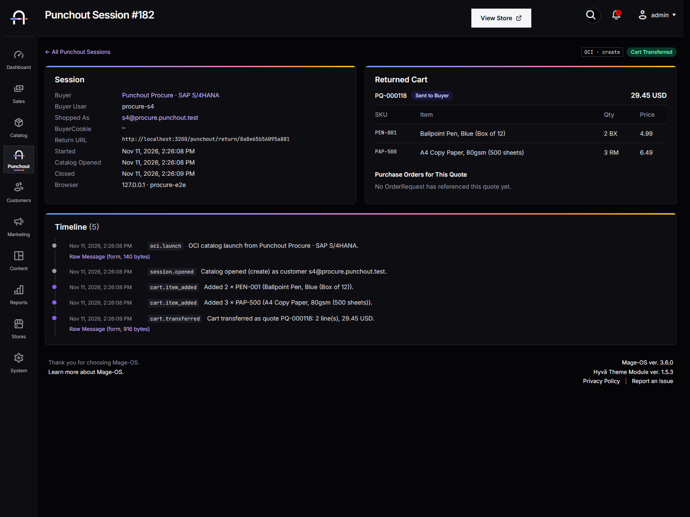
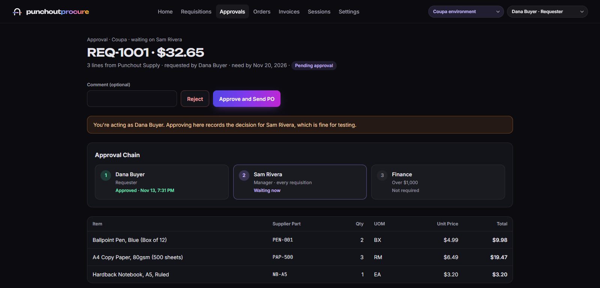

# Punchout Suite

Three tools for testing supplier-side procurement integrations end to end: **cXML and SAP OCI punchout**, purchase orders, ship notices, invoices, and payment. One tool plays the buyer, one plays the supplier, and one acts as a full Coupa, Ariba, or SAP procurement system.

> **Source code is private.** This repo is a showcase of what the tools do. Happy to walk through the code or the architecture on a call.

| Tool | What it is | Live |
|---|---|---|
| **Punchout Headquarters** | Buyer-side tester for cXML punchout, SAP OCI, and cXML orders | [punchouthq.com](https://punchouthq.com) |
| **Punchout Supply** | Magento 2 / Mage-OS extension that turns a store into a punchout supplier | [supply.punchouthq.com](https://supply.punchouthq.com) |
| **Punchout Procure** | Mock Coupa, SAP Ariba, and SAP S/4HANA buyer that runs full procure-to-pay | [procure.punchouthq.com](https://procure.punchouthq.com) |

## Why I built it

Suppliers usually can't test a punchout connection until a customer's procurement team is ready, and when something breaks, the error is buried in someone else's system. These tools let a supplier run every step on their own schedule and see the raw message behind each one.

## How the pieces fit

---

## Punchout Headquarters

Tests procurement connections from the buyer's side. Sends cXML PunchOutSetupRequests and SAP OCI launches, opens the supplier's catalog, and captures the returned cart. One click turns that cart into a cXML OrderRequest. A built-in mock supplier lets you run every flow without a live endpoint.

A full punchout session: request, supplier response, and returned cart, with every message saved.

The cXML tester. Basic mode builds the request from a form; advanced mode edits the raw XML.

**Stack:** Node.js, Express, Vercel

---

## Punchout Supply

A Magento 2 / Mage-OS extension (`PunchoutGateway_Supplier`) that makes any store a punchout supplier. The demo store runs in production mode on an Oracle Cloud server: [supply.punchouthq.com](https://supply.punchouthq.com).

- Buyers punch in from Coupa, Ariba, or SAP over cXML or OCI
- Contract pricing per buyer, cart sent back to their system
- POs become real Magento orders
- Confirmations, ship notices, invoices, and credit memos sent back as cXML
- Per-buyer setup: encrypted shared secrets, UOM and UNSPSC mapping
- Session timelines and logs of every message

One PO from received to paid, with the cXML at each step.

Every punchout session is logged step by step with the raw message, so it's easy to see where it breaks.

Per-buyer cXML credentials and OCI logins. Shared secrets are stored encrypted and never shown again.

**Stack:** PHP, Magento 2 / Mage-OS, Hyvä, Oracle Cloud (Ubuntu, arm64)

---

## Punchout Procure

A mock procurement system that behaves like the buyer platforms suppliers have to work with. It runs the full cycle against a supplier store: punchout requisition, approval chain, cXML PO, confirmation, ship notice, invoice, goods receipt, three-way match with price tolerance, and payment.

A Coupa PO from sent to paid, with the cXML for each step.

Cart returned by cXML punchout, landing on a requisition with commodity codes, UOM, and account coding.

Approval chain by amount, with a preview of the OrderRequest the supplier will receive.

Three-way match catches an invoice billed before goods were received, with options to request a credit, short pay, or reject.

Three buyer environments, each with its own rules: Coupa and SAP Ariba over cXML, SAP S/4HANA over OCI.

**Stack:** Node.js, Express, EJS, Redis, Vercel

---

## About me

I build supplier-side procurement integrations: punchout, catalogs, POs, and invoicing with Coupa, SAP Ariba, Oracle, and Zycus, plus the NetSuite scripting behind them. Available for consulting on Upwork.
