# Punchout HQ

A punchout platform for **any store and any procurement system**: cXML and SAP OCI punchout, purchase orders, confirmations, ship notices, invoices, credit memos, and payment. It has free testing tools anyone can use, two full sandboxes (one plays the buyer, one plays the supplier), catalog classification that puts the right UNSPSC code on every SKU, and a Readiness Check service that tests a supplier's store against their buyer's system before go-live.

> **Source code is private.** This repo is a showcase of what the platform does. Happy to walk through the code or the architecture on a call.

| Part | What it is | Where |
|---|---|---|
| **Punchout HQ** | Landing page: services, connectors, custom integrations | [punchouthq.com](https://punchouthq.com) |
| **Free Tools** | cXML PunchOut, OCI RoundTrip, and cXML Order testers. No sign-up | [tools.punchouthq.com](https://tools.punchouthq.com) |
| **Punchout Procure** | Mock buyer procurement system. Bring your own store and run procure-to-pay end to end | [overview](https://punchouthq.com/procure) · [sandbox](https://procure.punchouthq.com) |
| **Punchout Supply** | Mage-OS / Magento 2 extension that turns a store into a punchout supplier | [overview](https://punchouthq.com/supply) · [sandbox](https://supply.punchouthq.com) |
| **Punchout Classify** | UNSPSC classification for a whole catalog, fixing missing, too-broad and invalid codes. Free 100-SKU check | [punchouthq.com/classify](https://punchouthq.com/classify) |
| **Readiness Check** | Fixed-price test of a store against the buyer's system, with a pass/fail report | [book one](https://punchouthq.com/readiness-check) |

The sandboxes are open by request: each overview page has a request-access form.

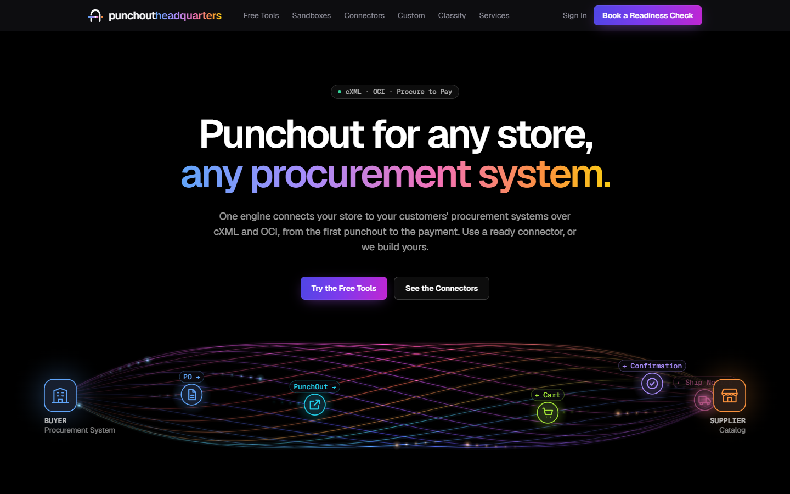

## Why I built it

Suppliers usually can't test a punchout connection until a customer's procurement team is ready, and when something breaks, the error is buried in someone else's system. Punchout HQ lets a supplier run every step on their own schedule, against the rules of the system their buyer actually uses, and see the raw message behind each one.

## How the pieces fit

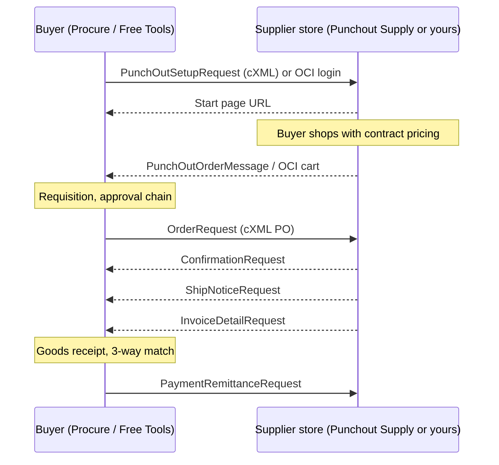

---

## Free Tools

Test a supplier's punchout from the buyer's side, with no account. Send a cXML PunchOutSetupRequest or an SAP OCI launch, shop the supplier's catalog, and capture the returned cart. One click turns that cart into a cXML OrderRequest. A built-in mock supplier lets you run every flow without a live endpoint.

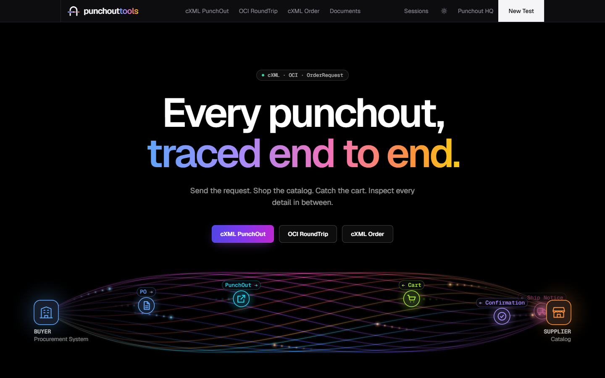

A full punchout session: request, supplier response, and returned cart, with every message saved.

The cXML tester. Basic mode builds the request from a form; advanced mode edits the raw XML.

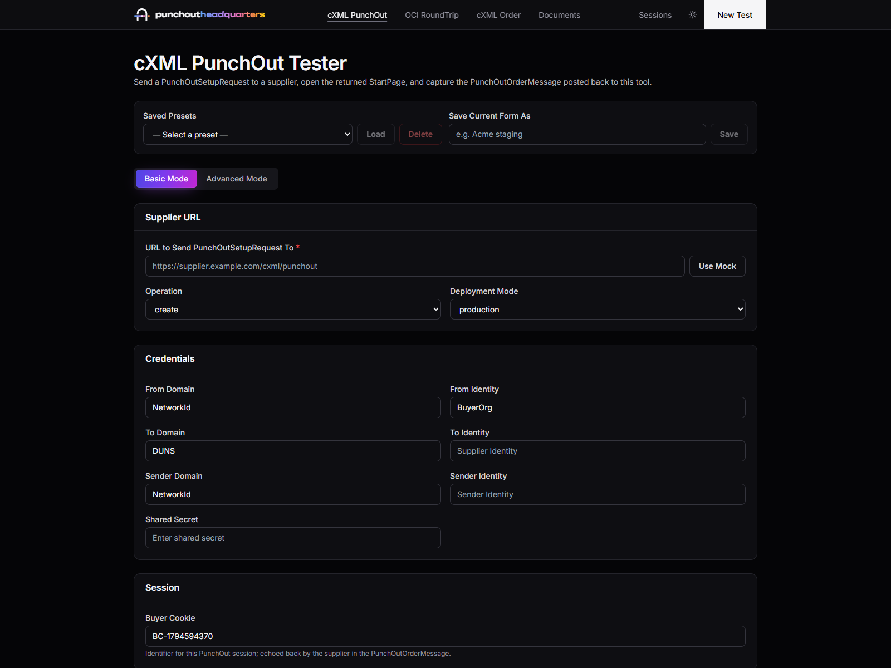

Built to be safe on the open internet:

- Each browser gets its own private workspace; sessions and documents are encrypted (AES-256-GCM) and deleted after 7 days
- Outbound requests are checked against private and internal addresses, including after every redirect
- Per-address rate limits; saved presets stay in the visitor's browser

**Stack:** Node.js, Express, EJS, Redis, Vercel

---

## Punchout Procure

A mock procurement system that behaves like the buyer platforms suppliers have to work with. It runs the full cycle against a supplier store: punchout requisition, approval chain, cXML PO, confirmation, ship notice, invoice, goods receipt, three-way match with price tolerance, and payment.

**Bring your own store.** Add your store's endpoints and credentials, turn on the buyer environments your customers use, and run the cycle against your own system. Credentials are encrypted and never shown again; deleting a supplier deletes its data. Every user works in their own workspace.

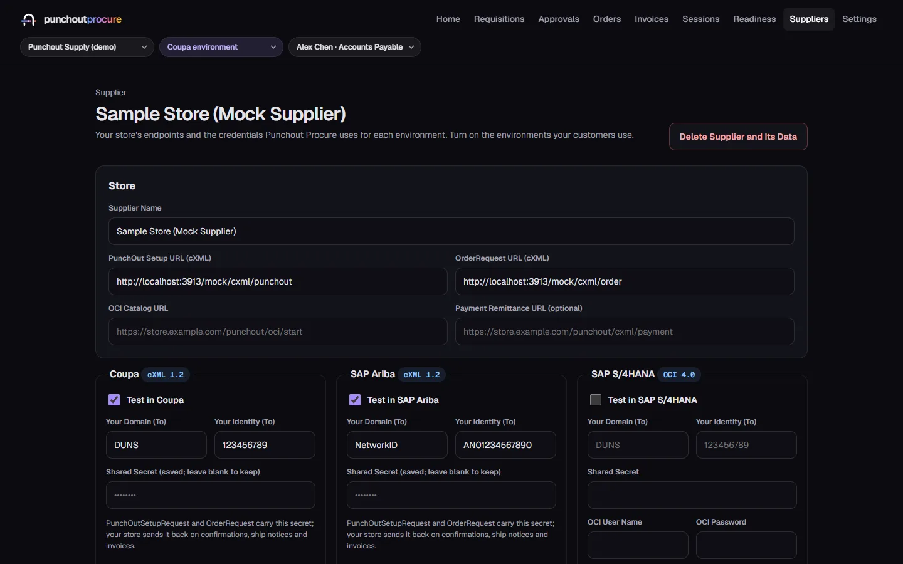

**Readiness checklist.** Everything the store has proven in each environment, built from the sessions, carts, orders, documents, and payments actually run.

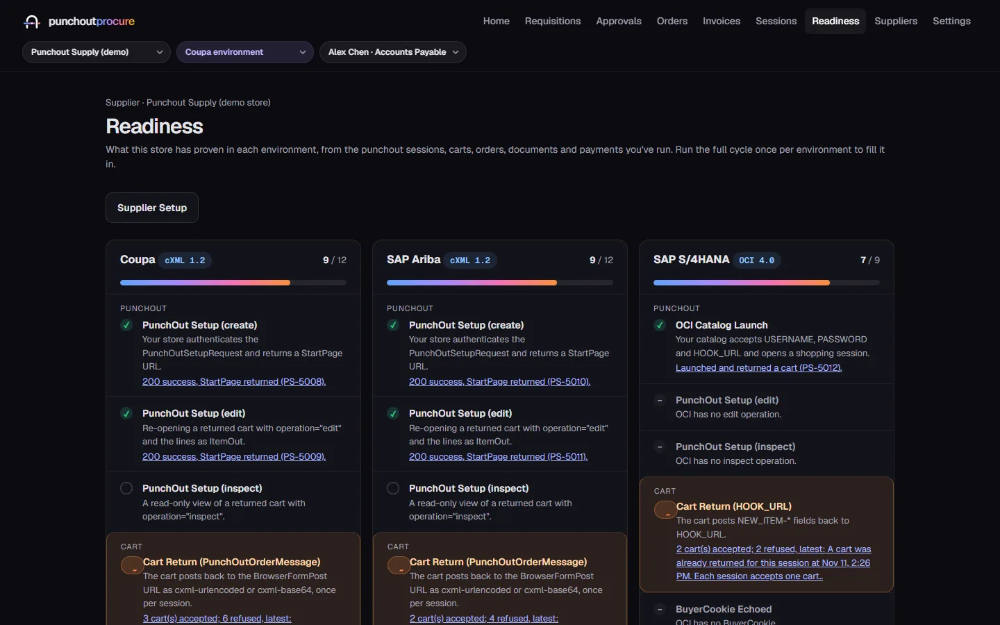

A PO from sent to paid, with the cXML for each step.

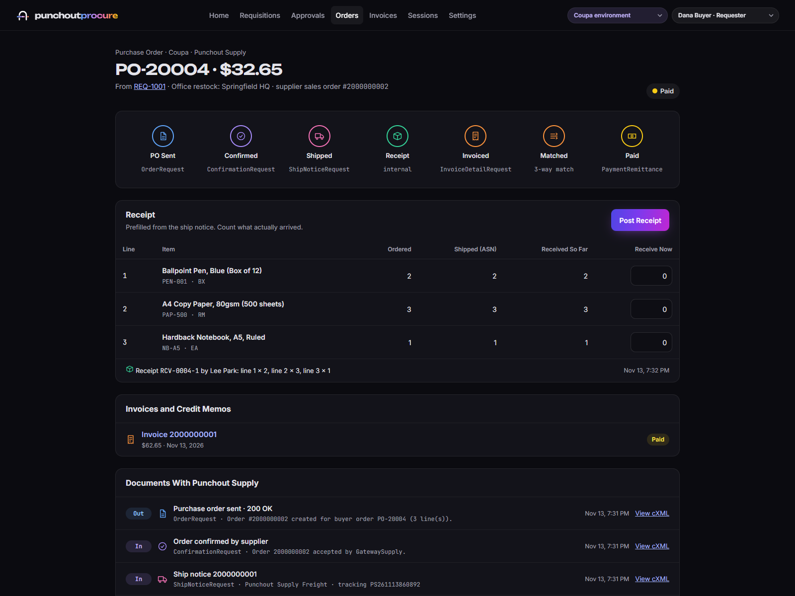

Cart returned by cXML punchout, landing on a requisition with commodity codes, UOM, and account coding.

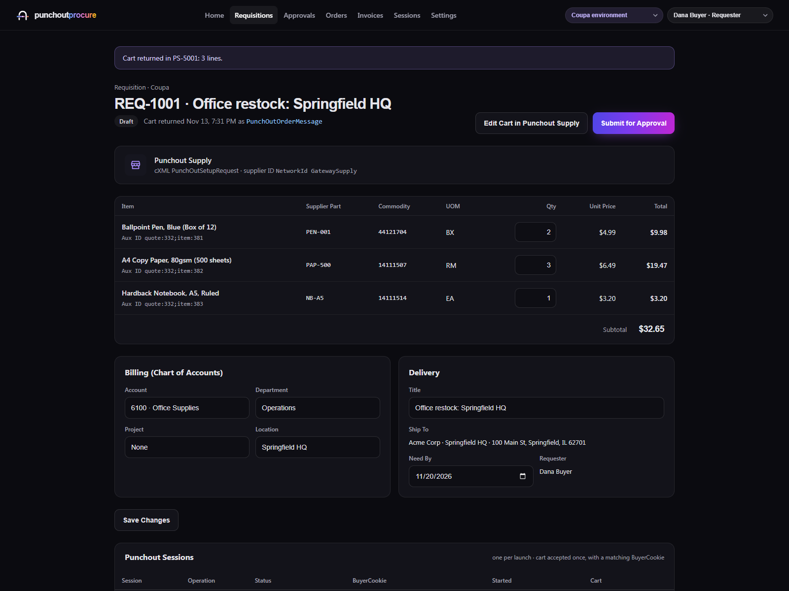

Approval chain by amount, with a preview of the OrderRequest the supplier will receive.

Three-way match catches an invoice billed before goods were received, with options to request a credit, short pay, or reject.

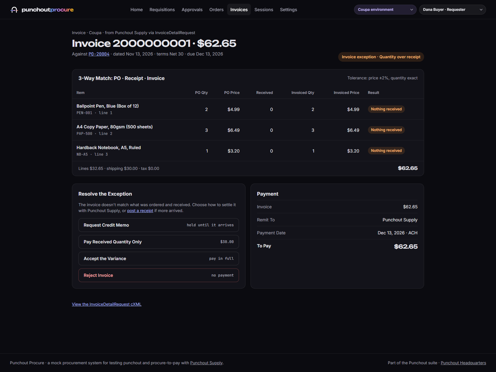

Buyer environments, each with its own rules and protocol: Coupa and SAP Ariba over cXML, SAP S/4HANA over OCI.

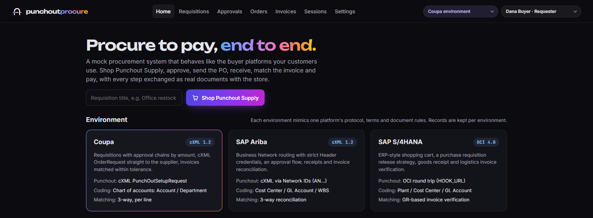

**Stack:** Node.js, Express, EJS, Redis, Vercel

---

## Punchout Supply

A Mage-OS / Magento 2 extension (`PunchoutGateway_Supplier`) that makes any store a punchout supplier. The demo store runs in production mode on an Oracle Cloud server: [supply.punchouthq.com](https://supply.punchouthq.com).

- Buyers punch in from any procurement system over cXML or OCI
- Shoppers from a buyer's system get a signed session pass, so they never hit a login page; the admin stays locked
- Contract pricing per buyer, cart sent back to their system
- POs become real orders
- Confirmations, ship notices, invoices, and credit memos sent back as cXML
- Per-buyer setup: encrypted shared secrets, UOM and UNSPSC mapping
- Session timelines and logs of every message
- A buyer readiness checklist for each connected buyer

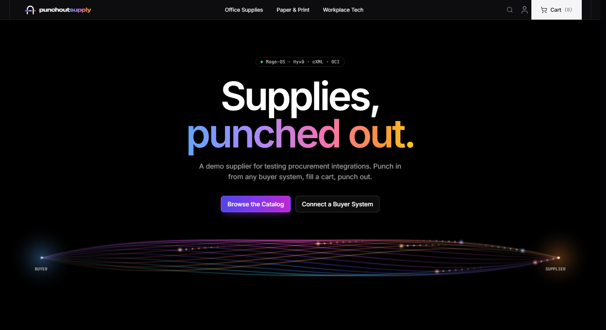

The buyer readiness checklist, built from that buyer's sessions and documents.

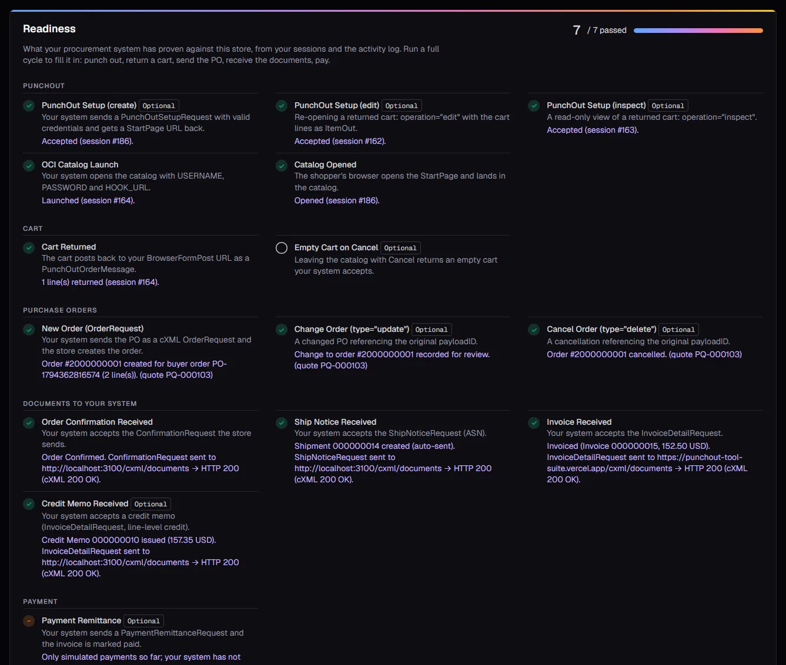

One PO from received to paid, with the cXML at each step.

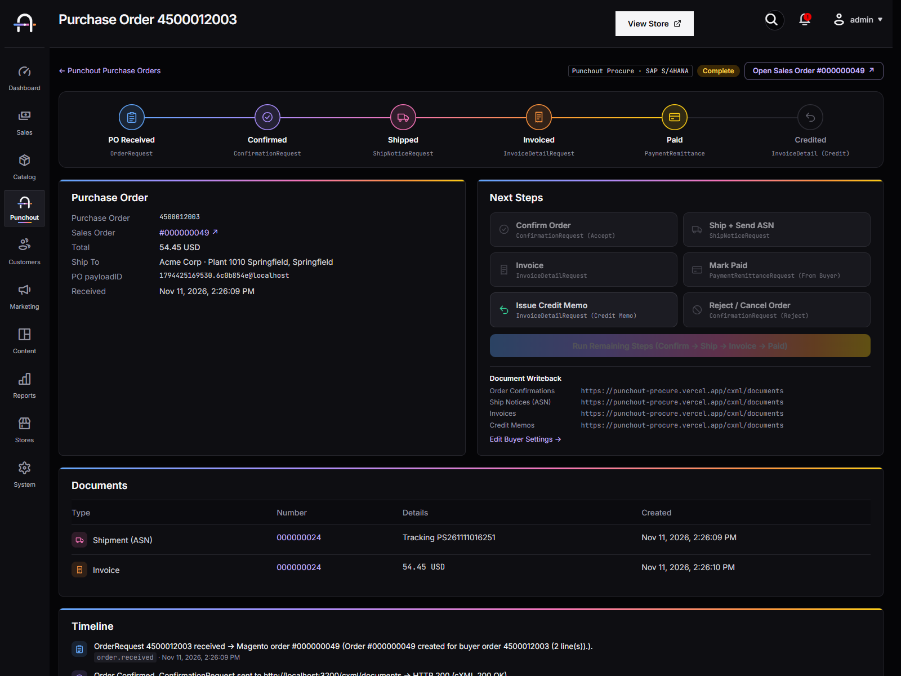

Every punchout session is logged step by step with the raw message, so it's easy to see where it breaks.

Per-buyer cXML credentials and OCI logins. Shared secrets are stored encrypted and never shown again.

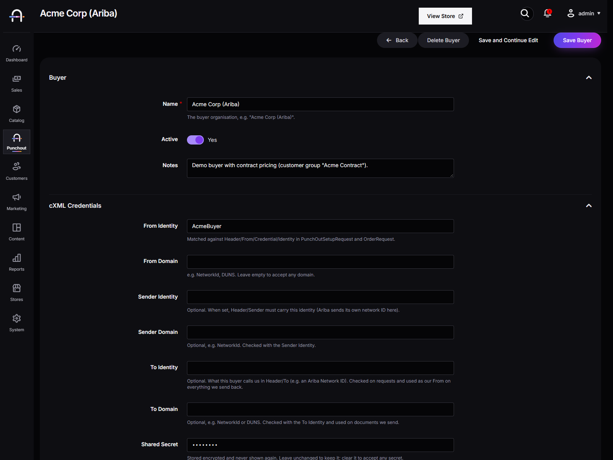

**Stack:** PHP, Mage-OS / Magento 2, Hyvä, Oracle Cloud (Ubuntu, arm64)

---

## Punchout Classify

Buyer systems reject carts with missing or wrong commodity codes, and most supplier catalogs are full of them: blanks, one segment code stamped on everything, neighbouring codes picked by hand, and codes that were never valid. Punchout Classify matches every SKU to the most specific UNSPSC commodity, checks it against the current release, and flags anything it isn't sure about. With a Punchout connector the codes go straight into the cXML `<Classification domain="UNSPSC">` and OCI `NEW_ITEM-MATGROUP` fields buyers read.

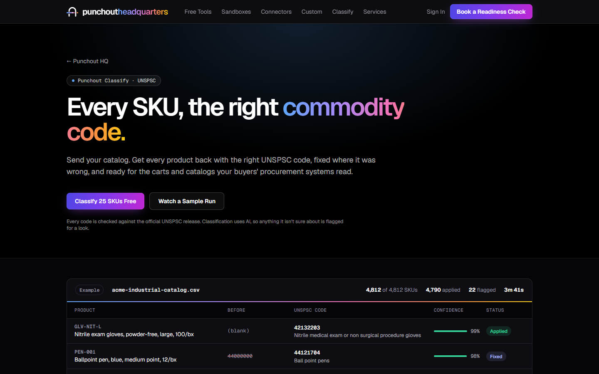

An example run: codes filled in, corrected, or flagged for a look, with the confidence for each.

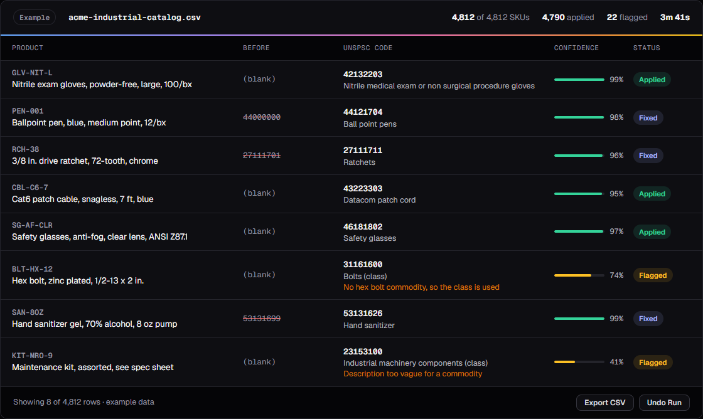

Anyone can send up to 100 products for a free check. A CSV is read in the browser, so only those rows are sent; requests are stored encrypted and land in the same review queue as sandbox access and Readiness Checks. Punchout Procure's readiness checklist points suppliers here when their cart lines are missing codes.

**How it classifies.** The matcher runs on the suite's own server, so product data never goes to an outside AI service and there is no per-SKU cost:

- All 149,905 commodities in the current UNSPSC release (UNv260801) are embedded once by a small open-source language model (bge-small, run with ONNX on ARM CPUs)
- Each product is cleaned of sizes, counts and model numbers, embedded the same way, and compared with every commodity; the closest matches are re-scored with keyword search (BM25) so exact terms count
- An existing code is kept when it fits, replaced when it is invalid, too broad (a segment, family or class) or clearly wrong, and anything ambiguous is flagged with the other likely codes for a person to check
- Results come back as a table in the review queue and a CSV with the code, commodity, confidence and a note for every SKU
- Requests to the matcher are signed (HMAC) and nothing is written to disk

**Stack:** Node.js, Transformers.js + ONNX Runtime, BM25, systemd + nginx on Oracle Cloud (arm64)

---

## Readiness Check

A fixed-price service: I connect a supplier's store to Punchout Procure as their buyer's system will see it, run the whole cycle (punchout, cart return, orders, confirmations, ship notices, invoices, credit memos, payment), and deliver a report with every step marked pass or fail, the message that broke, and what to change.

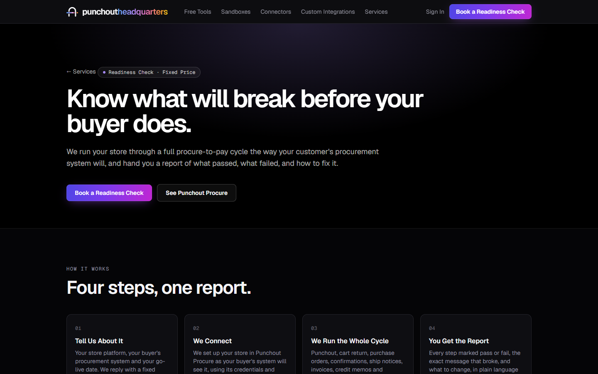

[Book a Readiness Check](https://punchouthq.com/readiness-check)

---

## About me

I build supplier-side procurement integrations for any procurement system: punchout, catalogs and catalog classification, POs, and invoicing over cXML, OCI, and EDI, delivered on Coupa, SAP Ariba, SAP S/4HANA, Oracle, and Zycus, plus the NetSuite scripting behind them. Available for consulting on Upwork, or email support@punchouthq.com.
